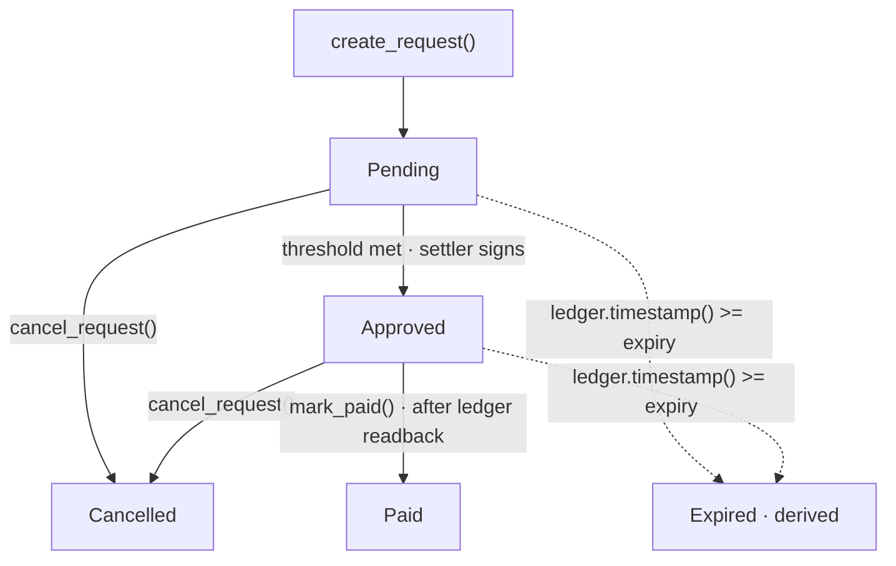

# 00 · The lifecycle

> *"SOW nêu đích danh ba trạng thái: pending → approved → paid."* — the deck, slide 10

## Expired is derived, not stored

The contract has no `Expired` status. It compares `env.ledger().timestamp()` against `expiry` on
every call, so a lapsed request is still stored as `Pending` — `is_payable` simply returns false.

A sweep in the backend materialises `expired` into the database so the list screen can filter on
it. That is presentation, not truth.

## Both terminal states are terminal

There is no edge out of `Paid` or `Cancelled`. A mistake after that point is a new request, never
an edit. `a_paid_request_cannot_be_cancelled` and `a_cancelled_request_cannot_be_paid` hold that
shut.

Source: `smart-contract/src/lib.rs`, `smart-contract/src/invariant.rs`.
