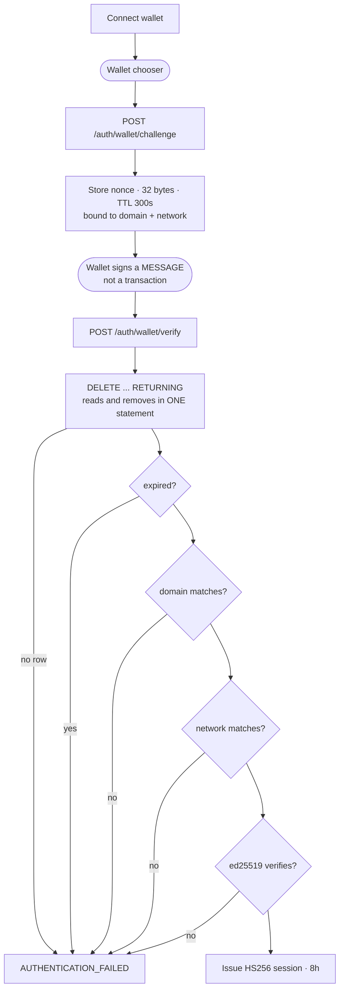

# 01 · Wallet sign-in

> *"Kết nối ví & ký challenge — chứng minh quyền kiểm soát địa chỉ; không chuyển tài sản."* — S-02

## Why the take is one statement

`SELECT` then `DELETE` has a window between them, and a captured challenge replayed into that
window authenticates twice. `DELETE … RETURNING` has no window, which is what makes a nonce single
use.

## Why every refusal looks the same

`X` is one node on purpose. Every failure returns the same message after the same delay, so
nothing reveals whether an address is enrolled. The distinguishing reason goes to the log, never to
the client.

Source: `backend/crates/settle-auth/src/challenge.rs`, `backend/crates/settle-db/src/challenges.rs`.
