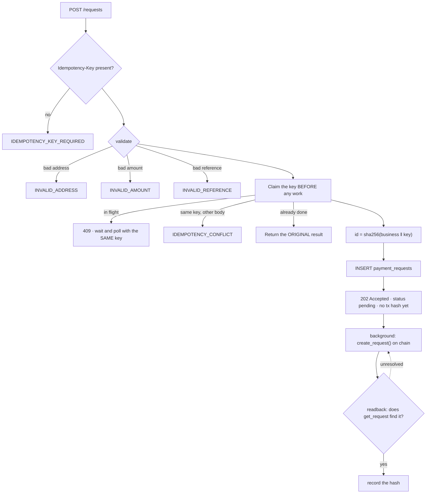

# 02 · Creating a payment

> *"Kết quả chưa rõ không phải là lỗi để hiện toast rồi cho bấm lại."* — the deck, on S-11

## The dashed edge is the whole point

`J` back to `I` is a **readback** loop, not a resubmit loop. On an unresolved outcome the next pass
re-reads by the deterministic id; it does not create a second request. And it cannot: the id is
derived from the same inputs, so the contract's `RequestExists` gate catches a second attempt even
if the backend tried.

## Why 202 and not 200

At the moment the API answers, the chain write has been accepted and not confirmed. `200` would
let a client read "OK" as "recorded".

Source: `backend/crates/settle-backend/src/http.rs`, `backend/crates/settle-backend/src/tasks.rs`.
