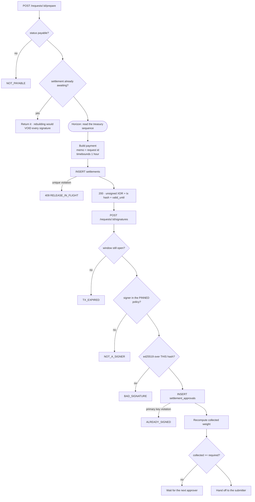

# 03 · Collecting signatures

## Three refusals, three codes

`NOT_A_SIGNER`, `BAD_SIGNATURE` and `ALREADY_SIGNED` are distinct because a caller who cannot tell
them apart cannot fix the problem. The last one is enforced by a primary key rather than by
application code — one signer contributing weight twice would reach a threshold of two alone,
which is the entire failure mode multisig exists to prevent.

## The pinned policy

`J` checks the policy version stored **on the settlement**, not the current one. A signer added
after authorisation does not get to approve work that was already in flight.

Source: `backend/crates/settle-signature/src/collector.rs`, `backend/migrations/0006_one_signer_signs_once.up.sql`.
