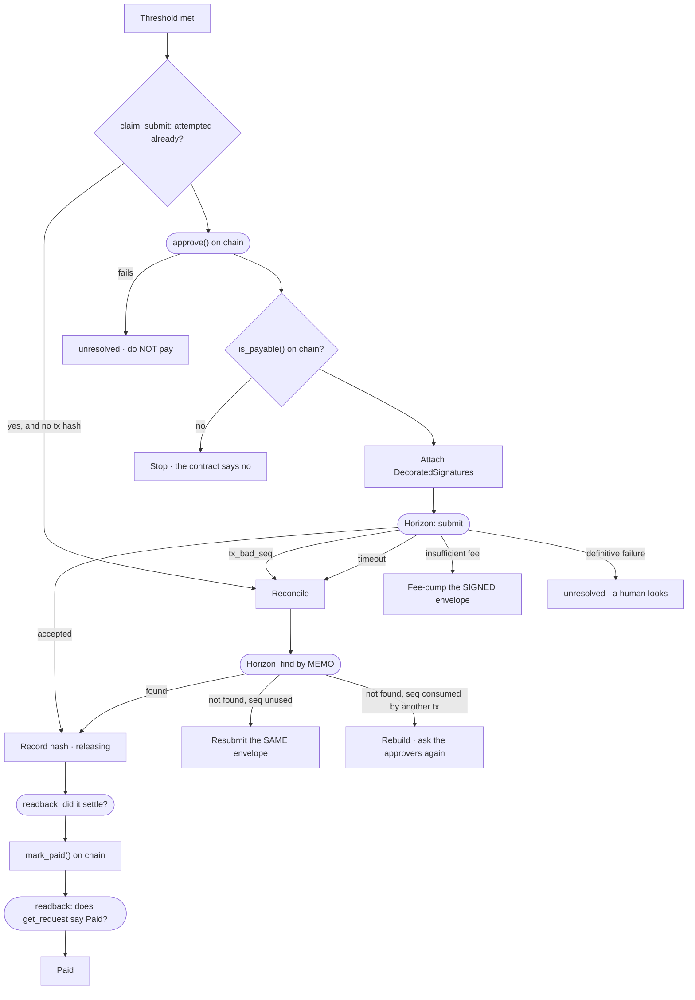

# 04 · Submitting, and the unclear answer

> *"tx_bad_seq chỉ nói seq đã bị tiêu, không nói ai tiêu."* — the deck, on S-28

## The two edges that decide whether a vendor is paid once

`tx_bad_seq` and `timeout` both go to `RC`, never to `RB`. `tx_bad_seq` says the sequence has been
consumed; it does not say by whom, and the most common cause is that *this envelope* already
reached the ledger. Rebuilding and re-collecting signatures pays twice.

Only `H → RB` reaches a rebuild, and only once the sequence is demonstrably consumed by a
different transaction.

## Why the memo lookup works at all

The memo is the request id, written into the transaction when it was built. A settlement whose
transaction hash was never received is still findable.

## Why the guard is the attempt, not the status

`B` checks `submit_attempted_at`. The status is `releasing` for the whole duration of a submit, so
a status check would let a redelivered queue message through and submit a second time.

Source: `backend/crates/settle-signature/src/reconcile.rs`, `backend/crates/settle-backend/src/tasks.rs`.
