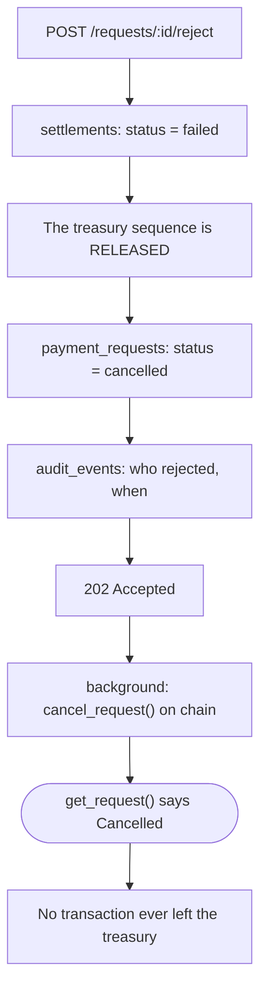

# 05 · Rejecting

> *"Nhánh reject phải dừng hẳn việc submit."* — S-18

## Releasing the sequence is not optional

`settlements_one_in_flight_per_treasury` does not cover `failed`, so marking a rejection failed
frees the treasury for the next payment. Without that step one refusal would block it indefinitely,
and the business would discover it at the next invoice.

## How the negative claim is proved

`I` cannot be shown with a link. The test queries the treasury's transaction list on chain and
asserts nothing is there for this settlement — against the account, not against our database. Our
database saying "cancelled" proves nothing about whether money moved.

Source: `backend/crates/settle-backend/src/http.rs`, `backend/migrations/0005_a_settlement_reserves_one_sequence.up.sql`.
